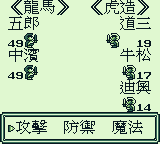
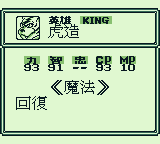

# 東京戰鬼（TOKIO SENKI）中文版補丁

**目前版本：v1.0**

本專案提供《東京戰鬼（TOKIO SENKI）》的非官方繁體中文版補丁。

## 對應 ROM 版本

### 日文原版（128KB）

- Database match：Tokio Senki - Eiyuu Retsuden (Japan)
- Database：No-Intro: Game Boy/Color (v. 20210227-015730)
- SHA-1：`1AA4F93A4AD0E0A273A723C70E01494F04B1F214`
- CRC32：`9DB7DCC3`

### 中文版（擴展至 256KB，V1.0）

- Database match：Not found
- Database：No-Intro: Game Boy/Color (v. 20210227-015730)
- SHA-1：`72C72EE4762D5770937FB1391479D1DDAAAB6D6A`
- CRC32：`A07F52CD`

### 中文版（擴展至 256KB，V1.0／無大特賣中版）

- Database match：Not found
- Database：No-Intro: Game Boy/Color (v. 20210227-015730)
- SHA-1：`FE8F232B2C01BD9E1C01352D36A5C1FDF4759828`
- CRC32：`760F6A96`

> 注意：本補丁僅包含個人製作之繁體中文化修改數據（IPS 檔），不含任何原始遊戲 ROM 檔案。請玩家自行準備合法取得之日文原版 ROM，並套用補丁。

版本差異

V1.0（含武器特賣事件）
參考原版中的未使用文字，新增武器特賣事件。

V1.0 No Bargain（不含武器特賣事件）
未加入武器特賣事件，保留日文原版的相關設定。

## 遊戲畫面

以下為繁體中文版的實際遊戲畫面。

### 標題畫面

### 劇本選擇

### 君主選擇

### 英雄與軍勢

### 魔法選擇

## 使用前須知

- 請自行準備合法取得的原版遊戲 ROM。
- 本專案不提供原版 ROM 檔案。
- 請確認補丁與 ROM 版本相符。

## 補丁套用方法

1. 準備原版 ROM。
2. 下載所需的補丁檔案（IPS）。
3. 使用支援該格式的補丁工具。
4. 將補丁套用至原版 ROM。
5. 完成後即可遊玩修改版。

## 免責聲明
本作品僅包含由製作團隊自行製作的翻譯補丁，與原遊戲製作公司及發行商無關。
本專案不包含、亦不授權使用任何原版遊戲 ROM、遊戲程式、圖像、文字或商標。
MIT License僅適用於本專案中的原創程式或腳本，不適用於第三方著作內容。

原遊戲及其相關著作權均屬於各自的權利人。
