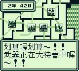
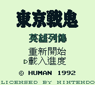
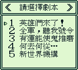
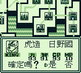

# 東京戰鬼（TOKIO SENKI）中文版補丁

**目前版本：v1.0**

本專案提供《東京戰鬼（TOKIO SENKI）》的非官方繁體中文版補丁。

## 對應 ROM 版本

### 日文原版（128KB）

- Database match：Tokio Senki - Eiyuu Retsuden (Japan)
- Database：No-Intro: Game Boy/Color (v. 20210227-015730)
- SHA-1：`1AA4F93A4AD0E0A273A723C70E01494F04B1F214`
- CRC32：`9DB7DCC3`

## 繁體中文版（擴充至 256 KB）

- **V1.0（一般完整版本）**
- **V1.0 No Bargain（不包含武器特賣事件）**

## 中文版 V1.0

- Database match：Not found
- Database：No-Intro: Game Boy/Color (v. 20210227-015730)
- SHA-1：`72C72EE4762D5770937FB1391479D1DDAAAB6D6A`
- CRC32：`A07F52CD`

## 中文版 V1.0 No Bargain

- Database match：Not found
- Database：No-Intro: Game Boy/Color (v. 20210227-015730)
- SHA-1：`FE8F232B2C01BD9E1C01352D36A5C1FDF4759828`
- CRC32：`760F6A96`

> 注意：本補丁僅包含製作團隊製作的繁體中文化修改資料（IPS 檔），不包含任何原始遊戲 ROM。
> 請玩家自行準備合法取得的日文原版 ROM，再套用本補丁。

## 版本差異

### V1.0（含武器特賣事件）
參考原版中的未使用文字，新增武器特賣事件。

### V1.0 No Bargain（不含武器特賣事件）
未加入武器特賣事件，保留日文原版的相關設定。

版本差異

V1.0（含武器特賣事件）
參考原版中的未使用文字，新增武器特賣事件。

V1.0 No Bargain（不含武器特賣事件）
未加入武器特賣事件，保留日文原版的相關設定。

## 遊戲畫面

以下為繁體中文版的實際遊戲畫面。

### 標題畫面

### 劇本選擇

### 君主選擇

### 英雄與軍勢

### 魔法選擇

## 使用前須知

- 請自行準備合法取得的原版遊戲 ROM。
- 本專案不提供原版 ROM 檔案。
- 請確認補丁與 ROM 版本相符。

## 補丁套用方法

1. 準備原版 ROM。
2. 下載所需的補丁檔案（IPS）。
3. 使用支援該格式的補丁工具。
4. 將補丁套用至原版 ROM。
5. 完成後即可遊玩修改版。

## 線上套用補丁（推薦）

可使用支援 IPS 格式的線上工具：

https://www.marcrobledo.com/RomPatcher.js/

使用前請確認：
1. 使用支援 IPS 格式的工具。
2. 準備合法取得的日文原版 ROM。
3. 優先選擇可在瀏覽器本機處理檔案、不需上傳 ROM 的工具。
4. 套用完成後，核對輸出 ROM 的校驗碼。

注意：本補丁僅包含製作團隊製作的繁體中文修改資料（IPS 檔），不包含任何原始遊戲 ROM。
請玩家自行準備合法取得的日文原版 ROM 再套用補丁。

## 版本與校驗碼

請先確認原版 ROM 為 **Tokio Senki - Eiyuu Retsuden (Japan)**。

| 版本 | 大小 | SHA-1 | CRC32 |
|---|---:|---|---|
| 日文原版 | 128 KB | `1AA4F93A4AD0E0A273A723C70E01494F04B1F214` | `9DB7DCC3` |
| 繁體中文版 V1.0 | 256 KB | `72C72EE4762D5770937FB1391479D1DDAAAB6D6A` | `A07F52CD` |
| 繁體中文版 V1.0 無大特賣中版 | 256 KB | `FE8F232B2C01BD9E1C01352D36A5C1FDF4759828` | `760F6A96` |

## 玩家回饋
若發現翻譯錯誤或遊戲問題，歡迎透過 GitHub Issues 回報。

回報時請提供：
- 問題發生的位置或畫面
- 重現步驟
- 使用的模擬器或實機環境
- 原版 ROM 的校驗碼
- 螢幕截圖或錄影（如有）

回報類型：
- 翻譯／文字：翻譯錯誤、錯字或排版問題
- 遊戲錯誤：無法操作、文字亂碼、當機或進度異常

## 免責聲明
本作品僅包含由製作團隊自行製作的翻譯補丁，與原遊戲製作公司及發行商無關。
本專案不包含、亦不授權使用任何原版遊戲 ROM、遊戲程式、圖像、文字或商標。
MIT License僅適用於本專案中的原創程式或腳本，不適用於第三方著作內容。
